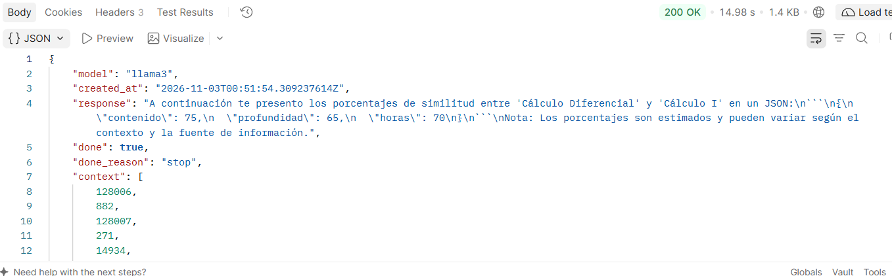
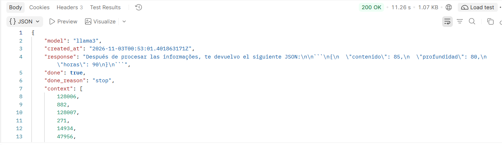
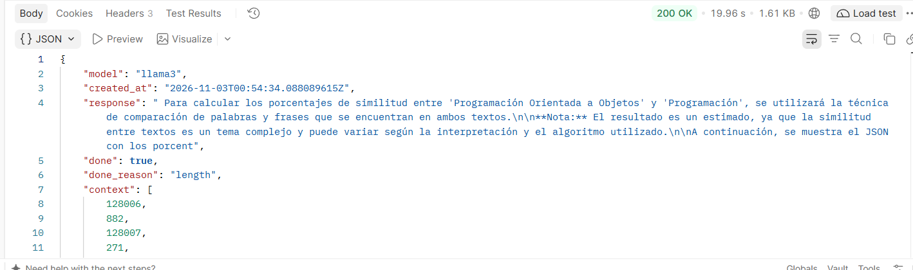
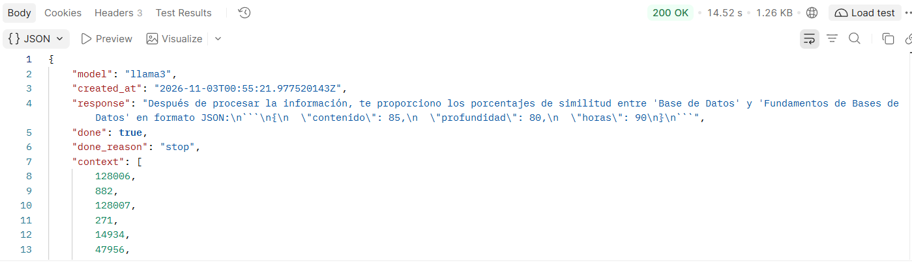
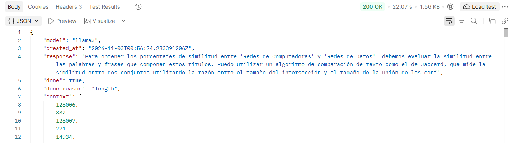

# Pruebas del Agente Interno - 5 Casos de Ejemplo

## Información del entorno
- **Modelo utilizado:** llama3
- **Fecha de prueba:** 02/11/2026
- **Responsable:** Katherine Moyolema
- **Tiempo máximo permitido (RNF-01):** 60 segundos

## Resultados de las pruebas

### Caso 1: Cálculo Diferencial
- **Tiempo de respuesta:** 14.98 segundos
- **¿Cumple el RNF-01 (< 60s)?:** Sí
- **Evidencia visual:**
  

### Caso 2: Física Básica
- **Tiempo de respuesta:** 11.26 segundos
- **¿Cumple el RNF-01 (< 60s)?:** Sí
- **Evidencia visual:**
  

### Caso 3: Programación Orientada a Objetos
- **Tiempo de respuesta:** 19.96 segundos
- **¿Cumple el RNF-01 (< 60s)?:** Sí
- **Evidencia visual:**
  

### Caso 4: Base de Datos
- **Tiempo de respuesta:** 14.52 segundos
- **¿Cumple el RNF-01 (< 60s)?:** Sí
- **Evidencia visual:**
  

### Caso 5: Redes de Computadoras
- **Tiempo de respuesta:** 22.07 segundos
- **¿Cumple el RNF-01 (< 60s)?:** Sí
- **Evidencia visual:**
  

## Conclusión
El agente respondió a los 5 casos con un **tiempo promedio de 16.56 segundos**, cumpliendo satisfactoriamente con el RNF-01 que establece un máximo de 60 segundos por asignatura. El rendimiento del modelo llama3 es óptimo para el análisis de homologación.