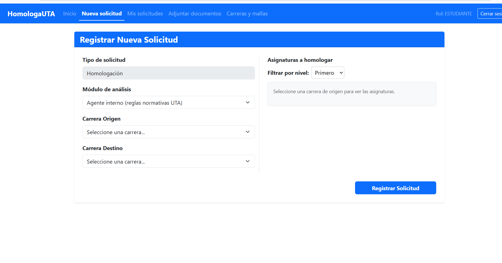
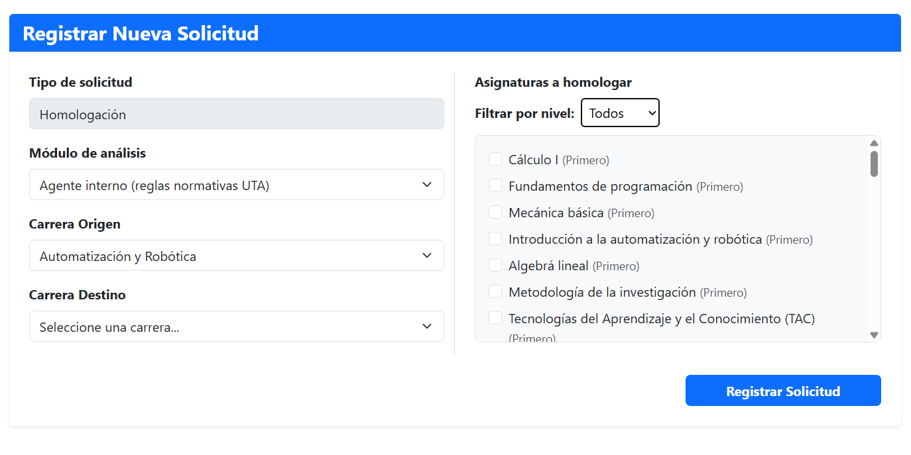
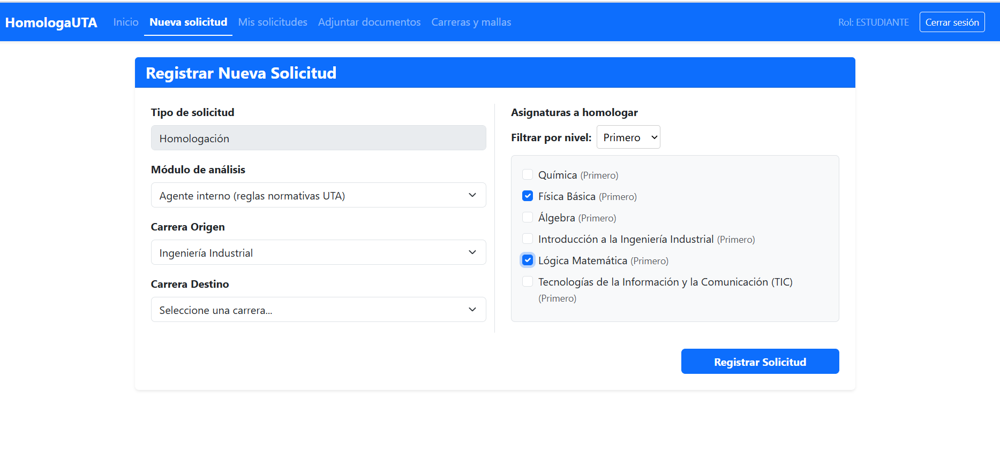
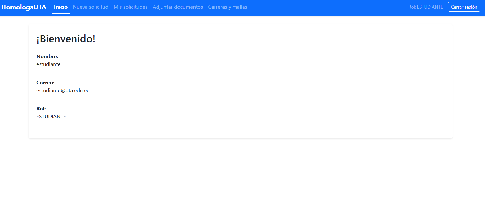

# Pruebas de la HU-11 - TA-11.4

## Información del entorno
- **Fecha de prueba:** 03/11/2026
- **Responsable:** Anahi Molina
- **Historias/Tareas probadas:** TA-11.1 (Tipo fijo), TA-11.2 (Filtro por nivel), TA-11.3 (Mis datos)

## Resultados de las pruebas

### 1. Prueba de registro de solicitud con tipo fijo Homologación
- **Escenario:** Se ingresa a la pantalla de "Nueva Solicitud" y se verifica que el tipo ya no sea un desplegable, sino un campo fijo que diga "Homologación".
- **Resultado:** El tipo se muestra como fijo (readOnly) y la solicitud se registra correctamente en la base de datos.
- **Evidencia visual:**
  

### 2. Prueba del filtro por nivel: Primero, Noveno y Todos
- **Escenario:** En la pantalla de Nueva Solicitud, se selecciona una carrera de origen y se prueba el filtro de nivel con las opciones "Primero", "Noveno" y "Todos".
- **Resultado:** La lista de asignaturas se filtra correctamente mostrando solo las del nivel seleccionado.
- **Evidencia visual:**
  

### 3. Prueba de conservación de asignaturas al cambiar de filtro
- **Escenario:** Se selecciona una asignatura en el nivel "Primero", luego se cambia el filtro a "Noveno" y se selecciona otra. Finalmente se vuelve a "Todos" o a "Primero".
- **Resultado:** Las asignaturas marcadas previamente se conservan seleccionadas sin perderse al cambiar de filtro.
- **Evidencia visual:**
  

### 4. Prueba de que Mis datos muestra el usuario correcto
- **Escenario:** Se inicia sesión con un usuario (ej. estudiante@uta.edu.ec) y se ingresa a la sección "Mis datos" / "Inicio".
- **Resultado:** Se muestra el nombre real del usuario (obtenido del backend), su correo y su rol, sin usar el nombre generado a partir del correo.
- **Evidencia visual:**
  

## Conclusión
La funcionalidad de la HU-11 cumple con todos los criterios de aceptación: el tipo fijo, el filtro por nivel funcional y persistente, y la correcta visualización de los datos del usuario autenticado.